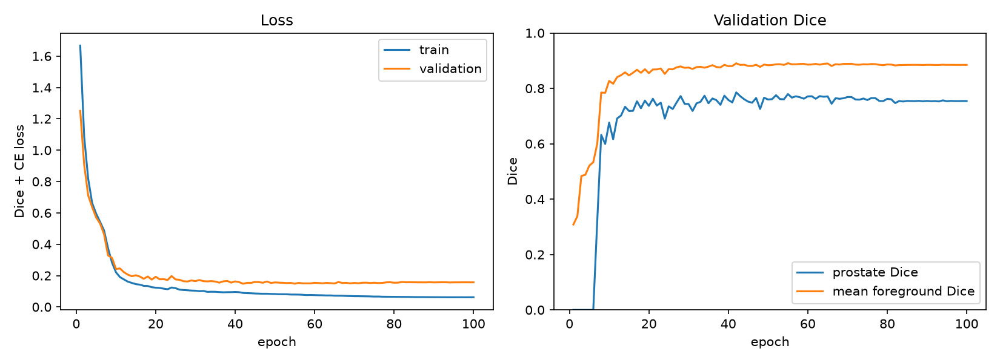
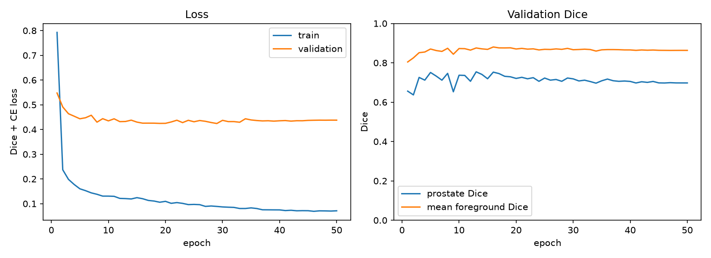
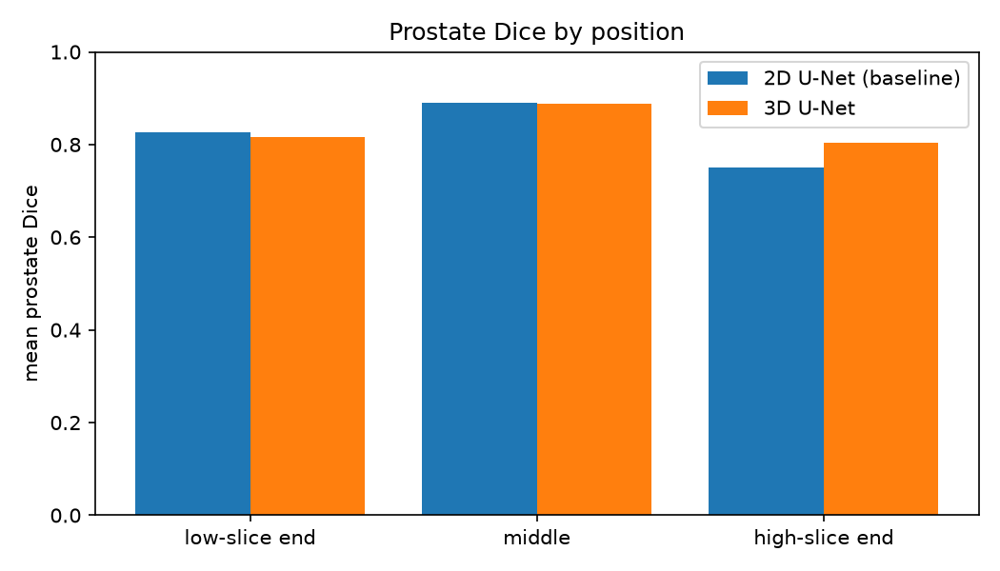
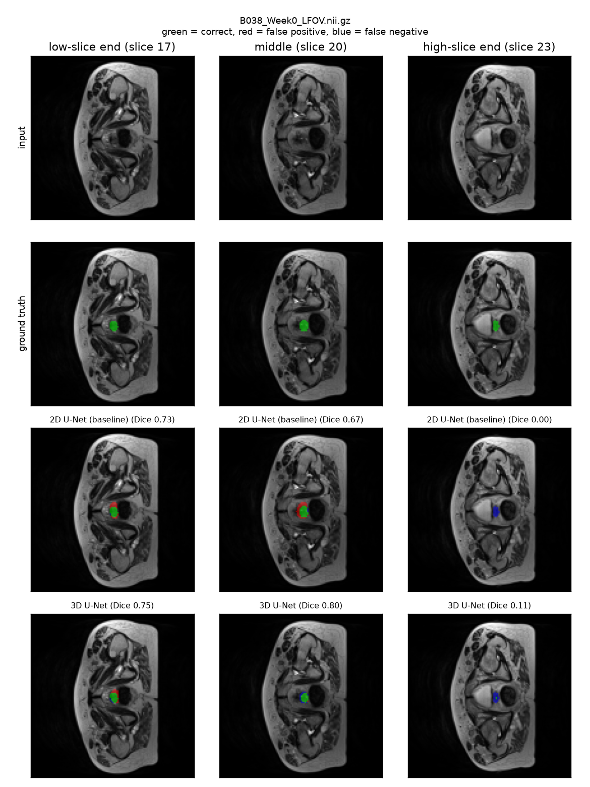
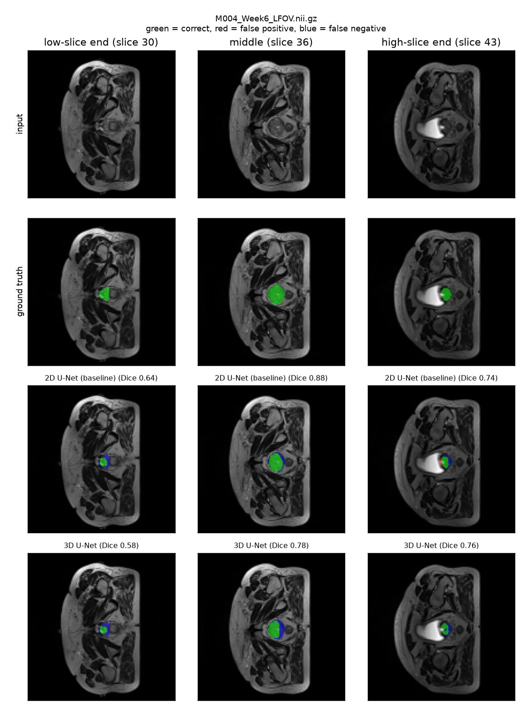
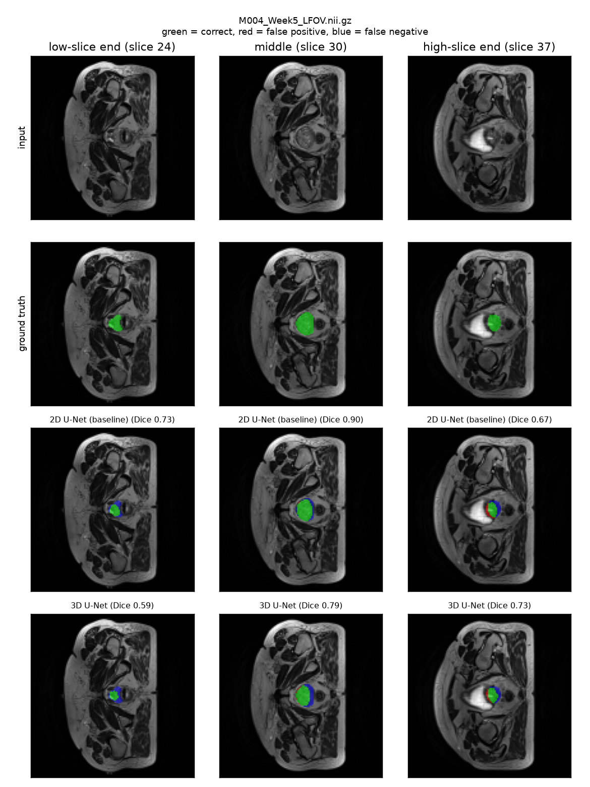

# 3D U-Net vs 2D U-Net Baseline for Prostate Segmentation on HipMRI

COMP3710 Pattern Recognition report · Student: Eliseo Furlan s4882661
Difficulty: Normal (3D U-Net) with a 2D U-Net baseline
---

## 1. Overview

**Problem.** 
Raidotherapy planning for prostate cancer and prostate contoured accuratly in MRI. This poject sgements the prostate from five other labels of the body from the slice including the baldder, rectum, background noise and class. in pelvic MRI from HipMRI_study dataset. The main argument stems from, does a 3d volumetric fix issues caused by 2d slices, for example missing out information between slices from a model standpoint or does the 3d simply wast more computing resources.

**How it works.** 
Both models are U-Nets both use an encoder and decoder. The encoder downsample data while the decoder upsamples it back to resolution with skip conncections included to help with training and resolotion that would be lost from downsampling carring the finer details for backpropagation. One for 2d converultions on each slice and one for 3d converultions aplied to the whole volume. The loss function used is soft Dice handling spatial overlap and ground truth labels as well as class imbalance (the prostate is very small compared to other labels) plus cross-entropy for stability. Both models use the same dataset.
---

## 2. Feasibility review 

**User need, scope and acceptance criteria.** 
The intended user is a radiation oncology specialist who reviews and edits AI-proposed prostate MRI's. The prototype’s purpose is to test whether 3D volumetric reduces boundary and slice errors compared with a 2D baseline.

Acceptance criteria:

| # | Criterion | Target |
|---|---|---|
| AC1 | 3D U-Net prostate Dice on the held-out test split | ≥ 0.70 |
| AC2 | Compared with the 2D baseline on the same split, report Dice separately for base, mid-gland and apex slices, and show whether the 3D model improves the worst-performing region.|
| AC3 | Predicted prostate lying on true bladder/rectum, 3D vs baseline |
| AC4 | peak training RAM ≤ 8 GB measured 2.85 GB and inference ≤ 0.5 s per volume measured |

**Model choice and course concepts.** 
I will use downsampled HipMRI data with a 3D U-Net, compared against a 2D U-Net baseline on 2D slices from the same patients. 
This is Normal difficulty. It draws on course concepts of like convolutions, skip connections, segmentation and Dice loss for class imbalance since the prostate occupies a small pecentage of the scan.


**Preliminary feasibility evidence.**
- *Data audit:* 211 volumes from 38 patients, 256×256×128 voxels, each paired with a six-class six-class segmentation.
- *Smoke test* (small separate models, 40 training volumes, A100): 

| | 2D baseline | 3D U-Net |
|---|---|---|
| Parameters | 117,478 | 339,974 |
| Peak training RAM | 0.45 GB | 2.85 GB |
| Prostate Dice (validation) | 0.643 | 0.675 |
| Dice apex / middle / base | 0.648 / 0.742 / 0.507 | 0.683 / 0.754 / 0.627 |

The 2D/3D difference mainly stems from a small subset coming from very few patients this was more of a blind run.


**Risks, budget and fallback.** 
•	Risk 1: 3D memory limits.
•	Risk 2: Severe class imbalance gives unstable Dice. (the soft dice and cross entropy should reduce this)
•	Risk 3: Data leakage across multiple volumes.
---

## 3. Repository structure

```
recognition/UNet3D_HipMRI_s4882661/
├── modules.py    # UNet(dim=2|3), Dice+CELoss, parameter, PyTorch
├── dataset.py    # patient-split, loading, downsampling
├── utils.py      # evaluation, plotting
├── train.py      # training, validation, testing
├── predict.py    # inference, model comparison
├── job_*.sh      # Slurm scripts for Rangpur
└── README.md
```
---

## 4. Dependencies and reproducibility

| Package | Version |
|---|---|
| Python | 3.13.5 |
| PyTorch | 2.14.0 |
| nibabel | 5.4.2 |
| numpy | 2.1.3 |
| matplotlib | 3.10.0 |

Hardware: one NVIDIA A100 on Rangpur (`comp3710` partition).

**To reproduce** 
(from this folder, with the data at `/home/groups/comp3710/HipMRI_Study_open`):

Using Sbatch:
`sbatch job_train_2d.sh`
`sbatch job_train_3d.sh`

then:
`sbatch job_predict.sh`
---

## 5. Data and preprocessing

**Data.** HipMRI study, 3D volumes: 211 MRIs from 38 patients, with labels 0 background, 1 body, 2 bone, 3 bladder, 4 rectum, 5 prostate. The label mapping was verified from per-label volumes. Volumes are 256×256×128, array axis 0 is left-right, and higher slice indices are superior (so the prostate base is the high-slice end and the apex the low-slice end).

**Preprocessing.**
- Volumes are downsampled to 128×128×64
- Images are z-score normalised.
- Training includes random left-right flips, intensity scale and shift and noise, applied identically to images.
- The 2D baseline uses all 64 slices of every volume cut from the same downsampled data as the 3D model.

**Splits.** Patients contribute several correlated scans, so the split is by patient ID, with a check that no patient appears in two splits. A split by file would put weeks of one patient in both training and test and inflate the results.

| Split | Patients | Volumes |
|---|---|---|
| Train | 27 | 154 |
| Validation | 6 | 31 |
| Test | 5 | 26 |


The test split is used once, at the end.
---

## 6. Models

- **2D U-Net (baseline):** depth: 3, bae channels: 16, parameters: 482534
- **3D U-Net:** depth: 3, bae channels: 16, parameters: 1401350
- Same code (`UNet(dim=2|3)`), so the models differ only in dimensionality.
- **Loss:** soft Dice over the five foreground classes + cross-entropy. **Optimiser:** AdamW.




The 2d base overfits more with a training loss of 0.07 against a validation of 0.43 where is validation and traing loss stagnate at epoch 5 to 14. The 3d loss gap is much smaller with a training loss of 0.07 and validation of 0.19 while also having a stabler validation dice around 0.76.
---

## 7. Results

### 7.1 Benchmark: baseline vs 3D (identical test volumes)

| Metric | 2D baseline | 3D U-Net |
|---|---|---|
| Prostate Dice | 0.831 | 0.842 |
| Prostate IoU | 0.717 | 0.733 |
| Dice, apex third | 0.826 | 0.815 |
| Dice, middle third | 0.891 | 0.888 |
| Dice, base third | 0.750 | 0.803 |
| Predicted prostate outside true slice range | 1.2% | 1.9% |
| Predicted prostate on true bladder / rectum | bladder:1.3%, rectum:0.0% | bladder:0.2%, rectum:0.1% |
| Mean foreground Dice (labels 1 to 5) | 0.893 | 0.894 |
| Best epoch / best validation prostate Dice | 13 / 0.754 | 42 / 0.785 |

Per-class Dice (bladder, rectum, etc.):
| background | body | bone | bladder | rectum | prostate |
|---|---|---|
| 2D | 0.994 | 0.979 | 0.896 | 0.910 | 0.846 | 0.831 |
| 3D | 0.997 | 0.985 | 0.908 | 0.920 | 0.815 | 0.842 |


### 7.2 Resource profile

| | 2D baseline | 3D U-Net |
|---|---|---|
| Trainable parameters | 482,534 | 1,401,350 |
| Peak training VRAM (GB) | 0.41 GB | 2.47 GB |
| Peak inference VRAM (GB) | 0.30 GB | 0.58 GB |
| Inference per volume (s) | 0.017 s | 0.017 s |
| Training epochs / batch size | 50 / 16 slices| 100 / 2 volumes |
| Total training time | 17.6 min | 17.1 min |

Has the same inference and training times so the main cost behind 3d compared to 2d boils down to memory. 

(The numbers come from `outputs/*_results.json`.)
---

## 8. Failure-case autopsies

### Case 1: B038_Week0

both compared similary and worst case for both models 2d dice is 0 while 3d didn't do much better with 0.11. missed a small postae compared to the ground truth. The gland is incredabili small containg only a small slice of the upper end. A possible hypothesis to this is a smaller gland than most training cases with the added fact of downsampling making the cross section hard to resolve and hard to spot from both models

### Case 2: M004_Week6

in this case 3d loses to 2d with a middle slice dice for 2d of 0.88 while 3d has 0.78. it shows the middle slice from the 3d to miss almost 1/3 of the prostate with the false negative cresent shape under segmenting the boundry the same can be said in week5 a possible reasson to this is maybe some sort of offset the model isn't seeing or is applying when it shouldn't.

### Case 3: M004_Week5

The 2d loses to the 3d here as seen in the upper slice where the gland tourches the bladder the 2d has large false positive while the 3d shrinks it from a dice value of 0.67 to 0.73 this would be because the 3d is better at boundry compared to the 2d's treating every slice individualy. However the middle slice has the same issue as M004_Week6 where the 3d has that same unusual cresent shape false negative with a dice score of 0.90 for 2d while 3d has 0.79.
---

## 9. Recommendation to the project manager

The 3D U-net gives an increased gainexactly as predicted. The Dice score rose from 0.750 to 0.803 at on base slices while also reducing bladder leakage onto other slices of pridicted voxels, However this only where 3d really shone elsewhere it offered no benfit compared to the 2d, middle dice of 0.891 comparded to 0.888 with an apex dice score of 0.826 compared to 0.815 overall improving scores by 0.11 while also not strongly affecting predicted slices even losing to 2d seen in M004 under-segmenting the middle slice. Both 2d and 3d share almost identical training and inference times with the only real "cost" between both is memory usage with 3d taking 6x the memory. It boils down to weather you have the resources to burn but arguably the 3d didn't contribute much and didn't improve many slices aside from impving leakage into other slices compared to 2d, the MRI images would still need review mainly at the base of the gland and at the blader, especially with small cross-sections that these models would miss or produce small predictions compared to the ground truth.
---

## 10. Limitations

-The test set only has 5 patients in it containgin 26 volumes. Three patients contributed 8 week scans. The overall dice scores of 0.842 vs 0.831 is well with in the 0.05 criteria. The validation also differed from testing, prostate Dice about 0.70 to 0.79 vs 0.83 to 0.84 which shows how the diffeent patients cross sections would give varing results.

-All volumes where downsampled from 56×256×128 to 128×128×64 esential halving resolution. Small boundrys and cross setion right on the apex or below would be lost due to how small the area is not to mention blurred with downsampled, scans would be almost invisible from prostate–bladder, prostate–rectum. Dice was used on the downsample grid not the full resolution and compred to against the prediction

-The 2d model has few paramters compared to 3d making the comparison is slitly skewed. Its gain would reflect capacity and a 2d models was not trained under the same circumstances.

-The data is locked to HipMRI and over slices of different patients was not test nor considered and generalization of other scans was not tested
---

## 11. Artificial Intelligence Usage Disclosure

- **Tools used:** Claude
- **What they helped with:** scaffolding README, debugging, asking question about links to helpful sites
- **How I audited and verified it:** read every file it posted line by line, identities and image orientation from the data myself, checked the patient split for overlap, ran a debug job before long runs.
---

## 12. References

1. O. Ronneberger, P. Fischer, T. Brox, "U-Net: Convolutional networks for biomedical image segmentation," MICCAI, 2015.
2. Ö. Çiçek et al., "3D U-Net: Learning dense volumetric segmentation from sparse annotation," MICCAI, 2016.
3. Arxiv.org. (2024, March 20). Dice Semimetric Losses:Optimizing the dice score with soft labels. arXiv.org e-Print archive. https://arxiv.org/html/2303.16296v4
4. Leaky-relu-improving-traditional-relu.md. (2019, October 15). GitHub. https://github.com/christianversloot/machine-learning-articles/blob/main/leaky-relu-improving-traditional-relu.md